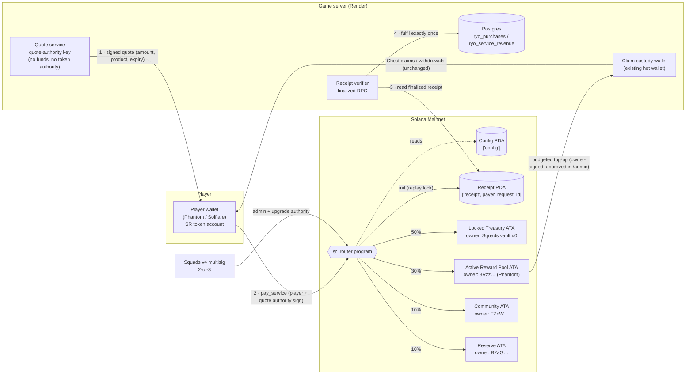
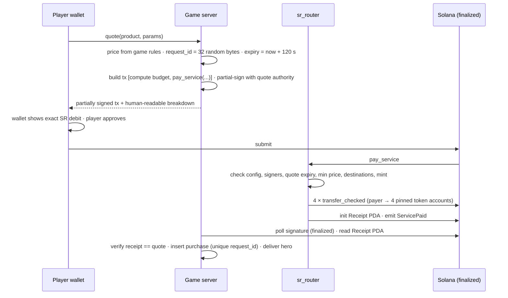

# Shinobi Bombers SR Router: Anchor design (player-signed purchases)

| | |
|---|---|
| **Status** | **Design only — awaiting owner approval.** Nothing is implemented, compiled, deployed or audited. |
| **Scope** | On-chain router for player-signed SR (Ryo) service purchases, atomic 50 / 30 / 10 / 10 distribution, migration from the current custody-signed adapter. |
| **Not in scope** | Withdrawals, chest claims, deposits, Sensei SOL, Market sales (unchanged; see §10). |
| **Restrictions honoured** | No Rust / Anchor / Solana CLI installed, no deployment, no change to live routing, no transfers, no Mainnet activation. |
| **Code in this document** | **Pseudocode.** Library names and APIs must be checked against the pinned versions at implementation time (§11). |

---

## 1. Goals and non-negotiables

1. **Live Chapter 04 split, enforced by the program:** 50% Locked Treasury, 30% Active Adventure Rewards, 10% Community Rewards, 10% Economic Reserve. Exact in base units, deterministic remainder.
2. **Phantom + budgeted top-ups for Active Rewards.** The 30% lands in the registered Active Reward Pool wallet (`3Rzz…Ti56`). Chest claims stay funded only by verified, independently approved top-ups into the game's claim float, exactly as today.
3. **Player-signed, atomic.** The player's own wallet pays. All four transfers and the receipt succeed together or nothing happens.
4. **PDAs, receipts, replay protection and multisig administration** throughout.
5. **The game custody wallet cannot bypass the router** for player-signed purchases: the tokens never pass through custody, and the server fulfils only against a program-created receipt.
6. **Nothing existing breaks.** Player balances, reward claims, withdrawals and pending transactions are preserved.
7. **Community funds first.** Destinations cannot be changed by any single key. Any administrative change is visible on-chain and in the dashboard before it takes effect.

---

## 2. Today vs. target

| | Today (custody-signed adapter, `sr-revenue` v2) | Target (`sr_router` program) |
|---|---|---|
| Who pays | Game custody wallet (`RYO_TREASURY_SECRET`) from the player's off-chain balance | **Player's wallet**, directly |
| Who enforces the split | Server code + DB checks | **On-chain program** |
| Can the custody key redirect funds? | Yes. It holds the tokens. | **No.** It never holds or signs for these tokens. |
| Replay protection | DB unique `(scope, wallet, request_id)` + memo hash | **Receipt PDA** (on-chain, one per request) + DB unique key |
| Proof for players / auditors | Transaction memo + server ledger | Receipt account + `ServicePaid` event, verifiable by anyone |

The custody-signed adapter remains correct for **balance-funded** purchases (players spending deposited
Ryo). Player-signed routing is an **additional** payment method that becomes the default. See the
migration plan in §8.

---

## 3. Architecture

### 3.1 Components



Plain-text summary of the same diagram:

```text
Player wallet ──pay_service──► sr_router ──► 50% Treasury ATA (Squads vault #0)
   ▲  (co-signed quote)            │      ├─► 30% Active Reward Pool ATA (3Rzz…, Phantom)
   │                               │      ├─► 10% Community ATA
Game quote service                 │      └─► 10% Reserve ATA
                                   └─► Receipt PDA ◄── game verifier (finalized) ──► DB fulfilment (once)
Active Reward Pool ──budgeted top-up──► claim custody ──► chest claims / withdrawals (unchanged)
Squads 2-of-3 ──► router admin + upgrade authority
```

### 3.2 Purchase sequence



If the transaction fails at any step, nothing moves and no receipt exists, so nothing is fulfilled.

---

## 4. Program design

### 4.1 Accounts

| Account | Seeds | Fields | Size (est.) |
|---|---|---|---|
| `Config` | `["config"]` | `version u8`, `admin Pubkey` (Squads vault), `guardian Pubkey` (pause-only), `quote_authority Pubkey`, `mint Pubkey`, `destinations [Pubkey; 4]` (token accounts, fixed order T/A/C/E), `min_price [u64; 8]` (per product id), `paused bool`, `pending_change Option<PendingChange>`, `bump u8` | ~400 B |
| `PendingChange` (inside Config) | — | `kind` (destinations / quote authority / min prices), `new_values`, `executable_after i64` | — |
| `Receipt` | `["receipt", payer, request_id]` | `version u8`, `payer Pubkey`, `request_id [u8;32]`, `product u8`, `amount u64`, `alloc [u64;4]`, `quote_expiry i64`, `slot u64`, `bump u8` | ~140 B |

- **Rates are constants in the program**, not config: `[5000, 3000, 1000, 1000]` bps. Changing Chapter 04 means a program upgrade (Squads-gated, audited), never a config flip.
- **Destinations are token accounts, not owners.** They are created in advance: the Treasury ATA owned by the Squads vault PDA, and the ATAs of the three registered wallets. Config pins them, so no account can be substituted at call time.

### 4.2 Instructions

```text
initialize(admin, guardian, quote_authority, mint, destinations[4], min_price[])
    once; signer = upgrade authority (Squads); verifies mint is classic SPL Token with 6 decimals,
    every destination is an initialized token account of `mint`, with no delegate and no close authority.

pay_service(request_id: [u8;32], product: u8, amount: u64, quote_expiry: i64)
    signers:  payer, quote_authority (== config.quote_authority)
    accounts: config (!paused), payer_token (owner == payer, mint == config.mint),
              dest_0..dest_3 (== config.destinations[i]), mint, token_program (== SPL Token id),
              receipt (init, payer = payer, seeds = ["receipt", payer, request_id])
    checks:   amount >= config.min_price[product] > 0 · Clock.unix_timestamp <= quote_expiry
              quote_expiry - now <= MAX_QUOTE_TTL (e.g. 300 s)
    split:    t = amount as u128
              a = t*5000/10000 · b = t*3000/10000 · c = t*1000/10000 · d = t - a - b - c   (d ≥ c, remainder ≤ 3 units)
    effects:  transfer_checked(payer_token → dest_i, alloc_i, decimals = 6) for i in 0..4   (skip zero legs)
              write receipt · emit ServicePaid { payer, request_id, product, amount, alloc, slot }

close_receipt()                       permissionless crank; only if quote_expiry + GRACE < now;
                                      rent returns to receipt.payer (replay is impossible after expiry)
pause() / unpause()                   pause: admin OR guardian · unpause: admin only
propose_change(kind, values)          signer = admin; sets pending_change with executable_after = now + CHANGE_DELAY
execute_change()                      permissionless after executable_after; re-validates token accounts
cancel_change()                       signer = admin OR guardian
```

`CHANGE_DELAY` applies to destinations, quote authority and minimum prices (recommended: 48 h; owner
decision). It **does not** apply to Treasury → reward-pool replenishment, which stays immediate under
Squads 2-of-3 as policy requires. The delay only protects *where new revenue goes*.

### 4.3 Price integrity: the co-signed quote

The program does not know game prices, so the amount must be authorised by the game.

- **Primary design:** `pay_service` requires a second signer, the **quote authority**, which is a dedicated server key. The server partially signs the exact transaction (amount, product, request_id, expiry); the player's wallet adds its signature.
- **Bounded blast radius:** the quote key holds no SR, no SOL beyond dust, and no token authority. If it is stolen, an attacker can only sign *underpriced* quotes for their own purchases. Funds are still split 50/30/10/10, `min_price` puts a floor on that abuse, and the key is rotated through `propose_change`.
- **Fallback design** (if Devnet testing shows target wallets modify partially-signed transactions, e.g. by injecting priority-fee instructions, which would invalidate the server signature): a two-step **Order PDA** (`["order", payer, request_id]`). The server creates the order (amount, expiry) in its own transaction; `pay_service` consumes and closes it. This costs one extra server transaction and its rent, which is returned when the order is consumed.
- **Not chosen:** ed25519-signature introspection through the instructions sysvar. It works but has a history of subtle verification bugs. Only reconsider it if both options above fail.

### 4.4 Invariants (audit checklist)

1. `sum(alloc) == amount` and `alloc` follows the constants exactly, for every `u64` amount.
2. Only `config.destinations` can receive funds, and only `payer_token` can be debited, by the `payer` signer.
3. A `(payer, request_id)` pair can produce at most one receipt while its quote is unexpired.
4. Classic SPL Token program only. `mint` must equal `config.mint`. Decimals are fixed at 6.
5. When `paused`, no funds can move.
6. No instruction lets any key withdraw from the destinations. The router never has authority over them.
7. Destination / authority changes are only possible through `propose_change` + delay, and `cancel_change` is always available to the admin and guardian.
8. All arithmetic is checked. Every account has its owner checked. There are no `remaining_accounts` in money paths.

---

## 5. Requirement 5: the custody wallet cannot bypass the router

| Bypass attempt | Why it fails |
|---|---|
| Custody key redirects a player-signed payment | The player's tokens move straight from the player's account to the four pinned accounts in one program call. Custody is not a signer and never holds these tokens. |
| Server "fulfils" a purchase without payment | The verifier fulfils only when a **finalized Receipt PDA** exists: owner = router program id, PDA = `(payer, request_id)`, and fields equal the stored quote. Custody cannot create receipts; only `pay_service` can, and only after the transfers succeed. |
| Server forges a receipt-looking account | Owner and PDA-derivation checks fail: only the router program can own an account at that address. |
| Custody key changes router destinations | Custody is not the admin, guardian or upgrade authority. A start-up check refuses to run if the custody key equals any of them, a Squads member or the quote authority. |
| A compromised server swaps destinations in the transaction it builds | The program ignores client-supplied destinations and checks each account against `config.destinations`. Any other account is rejected. |
| Custody signs a service payment from balance funds | Possible for **balance-funded** purchases (those tokens are custodial by definition). See §8 phase M4: those also move to the router, with custody as payer, so there is one auditable path, and deposits for spending can be sunset. |

**Residual trust:** the game server and database still decide *what* a player receives for a valid
receipt (heroes and items are off-chain). The router protects **funds**, not game-state integrity.

---

## 6. Security threat model

| # | Threat | Actor | Impact if unmitigated | Mitigation | Residual |
|---|---|---|---|---|---|
| T1 | Replay of a paid request | Player / attacker | Double fulfilment | Receipt PDA `init`; DB unique `request_id`; quote expiry | None while the receipt exists; after `close_receipt` the quote has expired |
| T2 | Underpayment / price tampering | Player | Cheap items | Quote-authority co-signature binds the amount; `min_price` floor; verifier compares receipt to the stored quote | Quote-key theft → underpriced items (funds still split correctly); rotate the key |
| T3 | Account substitution (fake destination, fake mint) | Attacker / compromised server | Funds misdirected | Pinned `config.destinations` and `mint`; owner checks; Token-program id check | None |
| T4 | Rounding / overflow | — | Lost or created units | `u128` math, checked ops, remainder to Reserve, property tests up to `u64::MAX` | None |
| T5 | Partial execution | — | Some legs paid, others not | Single instruction, single transaction: any failure reverts everything | None |
| T6 | Compromised game server or custody key | Attacker | Theft of custody float (player balances + topped-up rewards) | The router is outside custody; budgeted top-ups keep the float small; emergency pauses; custody ≠ any router authority | Custody float at risk (as today) |
| T7 | One Squads signer compromised | Attacker | — | Threshold 2; rotate via 2-of-3 config transaction; drift alerts | None |
| T8 | Two Squads signers compromised | Attacker | Malicious destination change or program upgrade | `CHANGE_DELAY` + guardian `cancel_change` + pause; dashboard / Discord alerts on any proposal; hardware wallets held by separate people | A malicious **upgrade** is not delayed by the program itself. Mitigate with Squads time lock on the *upgrade* vault only (owner decision) or by freezing the program after audit |
| T9 | Malicious or buggy program upgrade | Insider / bug | Arbitrary behaviour | Upgrade authority = Squads; verifiable builds (published hash); audit per release; optional freeze | Squads v4 program is itself upgradeable by its maintainers |
| T10 | Mint risks (Token-2022 hooks/fees, mint or freeze authority) | Issuer config | Unexpected fees, frozen accounts | `initialize` and the server refuse Token-2022, decimals ≠ 6, active mint or freeze authority | None if the checks pass at launch |
| T11 | Quote-authority key theft | Attacker | Underpriced purchases | No funds on the key; `min_price`; rate limits in the quote service; rotation with delay (guardian can pause meanwhile) | Bounded to item economy |
| T12 | Wallet modifies the partially-signed transaction | Wallet software | Payment fails (not unsafe) | Devnet test with Phantom / Solflare; fallback Order-PDA design | Usability only |
| T13 | RPC lies or lags | RPC provider | False fulfilment | Fulfil only at `finalized`; check genesis hash; read the receipt account *and* the transaction status; optional second RPC for large amounts | Low |
| T14 | Rent griefing / spam receipts | Attacker | Cost to attacker only | Payer funds receipt rent; quotes need the server co-signature, so arbitrary receipts are impossible | None |
| T15 | Front-running / MEV | Searcher | — | No price discovery or swaps; transfers are fixed | None |
| T16 | Clock skew | Validator | Quote accepted slightly late | Short TTL, `MAX_QUOTE_TTL` cap, on-chain `Clock` only | Seconds |
| T17 | Destination wallet key loss (Phantom) | Owner | Revenue sent to an unusable account | Custody migration option to Squads vaults ([CUSTODY_MIGRATION.md](CUSTODY_MIGRATION.md)); delayed destination change can redirect *future* revenue | Already-received funds |
| T18 | Phishing UI asks for broader approval | Attacker site | Token approval abuse | `pay_service` uses the player's direct signature, never an SPL `approve` / delegate; the UI shows the exact debit | None |

---

## 7. Active Rewards: Phantom + budgeted top-ups (unchanged policy)

- The router sends 30% to the **Active Reward Pool token account** owned by `3Rzz…Ti56`. The game never holds that key.
- Chest claims continue to be paid from the game's claim custody, funded only by top-ups:
  1. Owner sends from `3Rzz` (or the Treasury through Squads) to the claim custody wallet.
  2. An admin proposes **Verified SR rewards replenishment** in `/admin/`.
  3. A *different* approver approves it, and the server verifies the finalized transfer.
- Claims stay limited by the approved reward budget (24 h global cap, per-claim maximum, one claim per wallet per 24 h).
- **Future option (separate approval):** replace the claim float with a program-owned rewards vault whose `claim` instruction enforces the budget on-chain. That removes the remaining hot-wallet float for rewards. It needs its own design and audit.

---

## 8. Migration from the custody-signed system

Guiding rule: **add, verify, then switch**. Never convert or move existing balances.

| Phase | What changes | What stays the same | Exit criteria |
|---|---|---|---|
| **M0 — today** | — | Custody-signed v2 adapter (four legs, Squads verification); all money features OFF in pre-launch | — |
| **M1 — shadow** (Devnet / beta) | Router deployed on **Devnet** with a disposable mint and a Devnet Squads multisig; beta server gains `ROUTER_PLAYER_PAY=on` (Devnet only) | Live untouched | §9 test suite green; wallet partial-sign behaviour confirmed |
| **M2 — Mainnet deploy, paused** | Program deployed with `paused = true`; Squads is upgrade authority + admin; destinations initialised from the registry; verifiable build published | Live payments still custody-signed (or not yet launched) | Independent verification of program hash, config and destinations; audit report closed |
| **M3 — player-signed canary** | "Pay from wallet" offered for **one product** to allow-listed wallets; server verifies receipts | Balance-funded purchases, claims, withdrawals and deposits unchanged | N finalized receipts reconcile 1:1 with DB and on-chain balances; no incidents for an agreed period |
| **M4 — default** | Player-signed is the default for all approved services. Balance-funded purchases also call the router (`pay_service_custodial`: custody is payer, same split, same receipt) so there is **one auditable path** | Existing balances spendable; withdrawals 5% → Treasury; claims; pending orders | Dashboard shows 100% of service revenue with receipts |
| **M5 — custody reduction** (owner decision) | Optionally stop accepting *new* deposits for service spending; existing balances stay spendable and withdrawable | Withdrawals and claims | Custody float trends to the reward budget plus outstanding balances |

**Preservation guarantees during migration:**

- **Balances:** `ryo_accounts` is never rewritten. Router purchases do not touch off-chain balances; balance-funded purchases debit exactly as today.
- **Pending transactions:** custody-signed orders created before a switch recover with their **original persisted wire**, as today. A pending order is never rebuilt on a new path.
- **Claims and withdrawals:** untouched by the router. The 5% withdrawal deduction keeps its own ledger.
- **Accounting:** new column `ryo_purchases.route` (`custody-v1` | `custody-v2` | `router-v1`) plus `receipt_address`. `ryo_service_revenue` gains the receipt address. The dashboard reconciles receipts against DB rows against destination balance deltas.
- **Rollback:** set `ROUTER_PLAYER_PAY=off` (server) and/or `pause()` (on-chain). Players fall back to balance-funded checkout; nothing in flight is lost, because a paid receipt is still honoured by the verifier when the flag is off.

---

## 9. Devnet testing requirements (must pass before M2)

All on a local validator first, then Devnet, with a **disposable mint** and a **Devnet Squads multisig**.
No Mainnet keys are involved.

**Correctness**
- [ ] Split conservation for `amount ∈ {1, 2, 3, 9, 10, 11, 10001, 2^53+1, u64::MAX}` and 10,000 random values (property test); legs match the server's `splitRaw`.
- [ ] Zero-value legs are skipped without error (amount < 10 base units).
- [ ] The receipt contains exactly the paid amounts; the `ServicePaid` event matches the receipt.

**Atomicity and failure**
- [ ] A frozen / closed destination makes the whole transaction revert: no legs, no receipt.
- [ ] Insufficient payer balance reverts with no partial transfer.
- [ ] Paused config rejects; unpause by the guardian is rejected; unpause by the admin works.

**Replay and expiry**
- [ ] The same `(payer, request_id)` twice → second `init` fails.
- [ ] Expired quote rejected; TTL above `MAX_QUOTE_TTL` rejected.
- [ ] `close_receipt` before expiry + grace rejected; after it, rent returns to the payer.

**Authorization and substitution**
- [ ] Missing or wrong quote-authority signature rejected.
- [ ] Wrong destination, wrong mint, Token-2022 mint, wrong token program, and payer ≠ token owner are each rejected.
- [ ] `propose_change` by a non-admin rejected; `execute_change` before the delay rejected; guardian cancel works.
- [ ] Upgrade only through a Squads proposal; an upgrade attempt by any single key fails.

**Integration (beta server on Devnet)**
- [ ] Phantom and Solflare sign the partially-signed transaction without modifying it (or the fallback Order PDA is selected).
- [ ] The verifier fulfils exactly once under concurrent polling; it refuses non-finalized, failed, wrong-owner or wrong-PDA receipts.
- [ ] Gas preflight: the player needs SOL for fee + receipt rent; a clear message appears before signing.
- [ ] Reconciliation job: receipts = DB rows = destination balance deltas.
- [ ] Emergency pause in `/admin/` and on-chain `pause` both stop new purchases; pending ones resolve.
- [ ] The existing suites (`npm test`, rewards guard) stay green; beta behaviour is unchanged when the flag is off.

**Release**
- [ ] Verifiable build reproduces the deployed hash.
- [ ] External audit findings resolved.
- [ ] Owner sign-off on [ACTIVATION_CHECKLIST.md](ACTIVATION_CHECKLIST.md) items.

---

## 10. Explicitly unchanged

- Withdrawals: custody-signed, 95% to the player and 5% to the Locked Treasury (separate ledger), no cooldown, 100k minimum.
- Chest claims: once per 24 h within the approved budget; off-chain credit; existing caps.
- Deposits: 2% studio fee.
- Sensei SOL, Market sales, Boss Hunt prizes: separate policies, outside Chapter 04.
- The current custody-signed v2 adapter remains the live implementation until M3–M4 are approved.

---

## 11. Implementation phases (after approval)

| Step | Work | Output |
|---|---|---|
| I0 | Owner approves this design and the §12 decisions | Signed-off spec |
| I1 | Install and pin the toolchain (Rust, Solana CLI, Anchor) at then-current stable versions. Record exact versions; check every API used here against those versions' documentation. | `programs/sr_router/` scaffold, `Anchor.toml`, pinned versions |
| I2 | Program + unit/property tests on a local validator | §9 correctness, atomicity and authorization tests |
| I3 | Devnet deployment (Squads Devnet upgrade authority), beta-server integration behind `ROUTER_PLAYER_PAY` | §9 integration tests, screenshots |
| I4 | External audit + verifiable build | Audit report, published hash |
| I5 | Mainnet deploy **paused** (M2), independent config verification | Deployed, paused program |
| I6 | Canary → default (M3 → M4) with owner approval at each step | Reconciled receipts |

Estimated program size: four instructions on the money path, about 600–900 lines of Rust plus tests.
Compute: four `transfer_checked` CPIs plus account init, well under the default per-instruction budget.
This must be measured on Devnet.

---

## 12. Decisions needed from the owner

1. **Quote model:** co-signed transaction (recommended) or the Order-PDA fallback. Final choice after the Devnet wallet test.
2. **`CHANGE_DELAY`** for destination, quote-authority and min-price changes (recommended 48 h). Replenishment stays immediate.
3. **Guardian key:** a single pause-only key (recommended, held by the owner on a hardware wallet), or pause by Squads only.
4. **Upgrade protection:** Squads time lock on a dedicated *upgrade* vault, and/or freezing the program after audit.
5. **Balance-funded purchases at M4:** route through the router with custody as payer (recommended), or keep the current adapter for them.
6. **M5:** whether to stop new deposits for service spending once player-signed payments are the default.
7. **Destinations:** keep the Phantom wallets or move Community / Reserve / Active Rewards to Squads vaults first ([CUSTODY_MIGRATION.md](CUSTODY_MIGRATION.md)). Changing destinations later is possible, but goes through the delay.

---

## Appendix A — optional program-owned Treasury vault (separate approval)

A plain Squads vault cannot guarantee "reward-pool-only" spending: two signers can approve any transfer.
If that guarantee is wanted, the 50% destination becomes a token account owned by a `treasury_vault` PDA.

```text
Vault ["treasury_vault"]: admin (Squads vault), reward_destination (Active Reward Pool token account),
                          cap_24h, cap_30d, rolling usage, paused, bump
replenish(amount)         signer = admin (Squads 2-of-3); destination MUST equal reward_destination;
                          rolling caps enforced; no timelock (policy: Treasury stays available)
set_caps / set_reward_destination   through the same propose_change + CHANGE_DELAY pattern as the router
pause / unpause           admin; guardian may pause only
```

**Effect:** even with two colluding signers, Treasury SR can only flow to the Active Reward Pool within the
caps, unless the program is maliciously upgraded (see T8 / T9).

**Cost:** a second program and audit, and a **new Treasury address**. That address change goes through
the registry PR and the router's delayed destination change.
